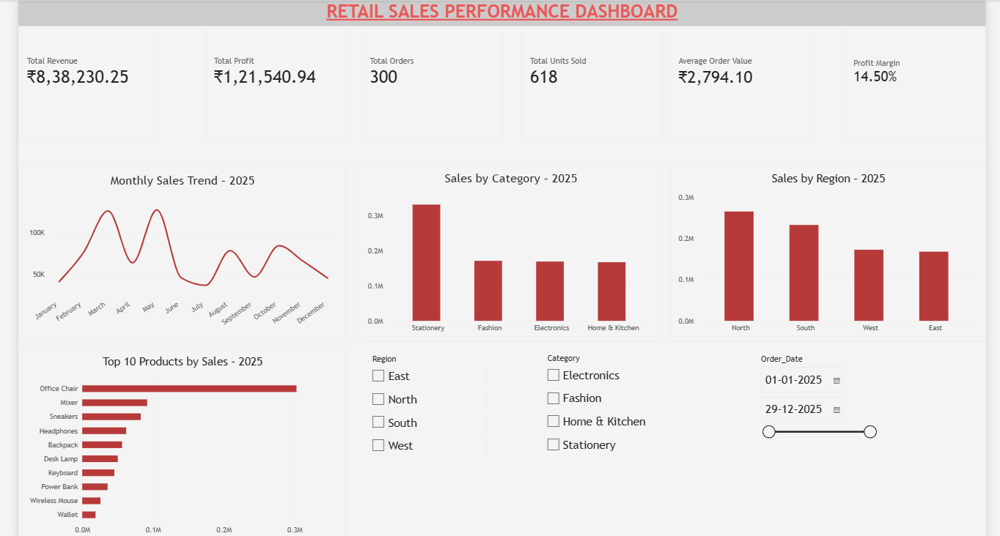

# Retail Sales Performance Analysis – 2025

## 1. Project Overview

This project analyses retail sales data for 2025 to identify sales trends, evaluate regional and product performance, measure profitability, and generate actionable business insights.

The project uses Excel, Python (Pandas), and Power BI to perform data analysis and create an interactive dashboard.

## 2. Business Problem

The retail business needs to understand its sales performance across different regions, product categories, and individual products.

The analysis answers the following questions:

- Which region generates the highest revenue?
- Which product category contributes the most sales?
- Which products generate the highest revenue?
- Which months perform best and worst?
- Which products and categories have lower profit margins?
- How can the business improve sales and profitability?

## 3. Project Objectives

- Analyse overall retail sales performance.
- Identify monthly sales trends.
- Compare regional and category performance.
- Identify top-performing products.
- Calculate important business KPIs.
- Build an interactive Power BI dashboard.
- Provide data-driven business recommendations.

## 4. Tools and Technologies

| Tool | Purpose |
|---|---|
| Microsoft Excel | Data exploration and analysis |
| Python | Data inspection and validation |
| Pandas | Data manipulation and analysis |
| Power BI | Interactive dashboard development |
| DAX | KPI calculations and measures |

## 5. Dataset Description

- Dataset: Retail Sales Dataset
- Period: January–December 2025
- Total records: 300
- Total columns: 12

### Dataset Columns

Order_ID, Order_Date, Region, City, Category, Product, Quantity, Unit_Price_INR, Discount_Pct, Sales_INR, Profit_INR, Payment_Method.

## 6. Data Cleaning and Validation

The dataset was inspected using Python and Pandas.

Validation performed:

- Checked dataset dimensions and column names.
- Checked missing values.
- Checked exact duplicate records.
- Checked duplicate Order IDs.
- Validated sales calculations using quantity, unit price, and discount.
- Reviewed records with zero profit.

### Data Quality Results

- Missing values: 0
- Exact duplicate rows: 0
- Duplicate Order IDs: 0
- Sales calculation mismatches: 0
- Zero-profit orders identified: 2

The two zero-profit orders were retained rather than automatically treated as errors.

## 7. Key Performance Indicators

| KPI | Result |
|---|---:|
| Total Revenue | ₹8,38,230.25 |
| Total Profit | ₹1,21,540.94 |
| Total Orders | 300 |
| Total Units Sold | 618 |
| Average Order Value | ₹2,794.10 |
| Profit Margin | 14.50% |

## 8. Key Business Insights

### Monthly Performance

- May recorded the highest revenue of ₹1,27,826.
- July recorded the lowest revenue of ₹36,493.
- December recorded the highest monthly profit margin of 18.84%.

### Regional Performance

- North generated the highest revenue at ₹2,65,255.95.
- West achieved the highest regional profit margin at 16.79%.
- South had the lowest regional profit margin at 12.65%.

### Category Performance

- Stationery generated the highest revenue at ₹3,31,189.60.
- Stationery had the lowest category profit margin at 11.87%.
- Fashion achieved the highest category profit margin at 16.47%.

### Product Performance

- Office Chair generated the highest product revenue at ₹3,02,719.95.
- Office Chair also generated the highest product profit.
- Pens Set recorded the highest product profit margin at 36.31%.
- Office Chair had a comparatively low profit margin of 9.97%.

## 9. Power BI Dashboard Features

The interactive dashboard includes:

- Total Revenue KPI card.
- Total Profit KPI card.
- Total Orders KPI card.
- Total Units Sold KPI card.
- Average Order Value KPI card.
- Profit Margin KPI card.
- Monthly Sales Trend chart.
- Sales by Category chart.
- Sales by Region chart.
- Top 10 Products by Sales chart.
- Region slicer.
- Category slicer.
- Order Date slicer.

The slicers allow users to analyse sales performance dynamically using different filters.

## 10. Business Recommendations

1. Investigate the reasons behind the lower sales recorded in July.
2. Review Stationery pricing, discounting, and cost structure to improve its profit margin.
3. Analyse the South region to identify opportunities for improving profitability.
4. Review Office Chair pricing and costs because it generates high revenue but has a relatively low margin.
5. Study high-margin products such as Pens Set and Planner for opportunities to improve their sales contribution.

## 11. Conclusion

This project demonstrates the use of Excel, Python, Pandas, Power BI, and DAX to transform raw retail sales data into meaningful business insights.

The interactive dashboard helps stakeholders monitor business performance, identify trends, compare product and regional results, and make informed decisions.

## 12. Project Information

**Project:** Retail Sales Performance Analysis – 2025

**Tools:** Excel | Python | Pandas | Power BI | DAX

**Project Type:** Retail Sales Data Analysis and Business Intelligence Dashboard

## 13. Project Structure

```text
Retail_Sales_Analysis/
├── PYTHON/
├── OUTPUTS/
├── DOCUMENTATION/
├── IMAGES/
├── Retail_Sales_Analysis.xlsx
└── Retail_Sales_Analysis.pbix
```


## Power BI Dashboard Preview



## How to Run This Project

### 1. Clone the Repository
Download or clone this repository to your local computer.

### 2. Install Required Python Libraries

```bash
pip install pandas openpyxl